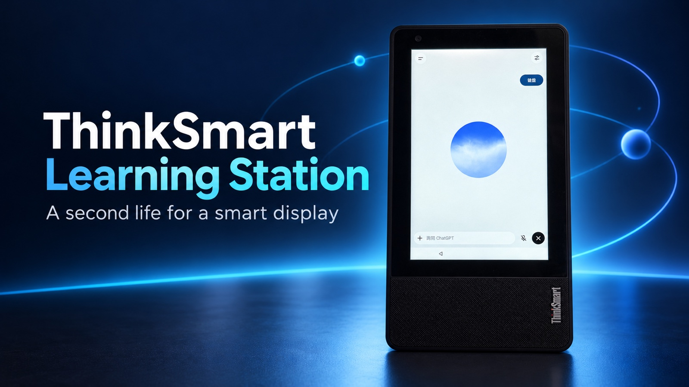
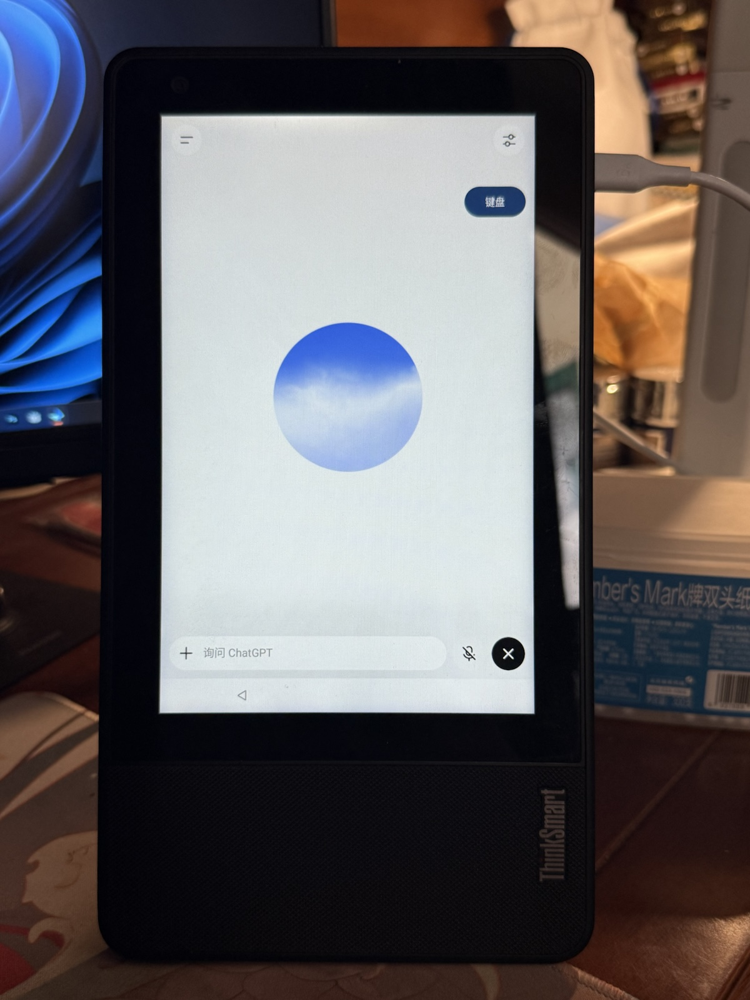
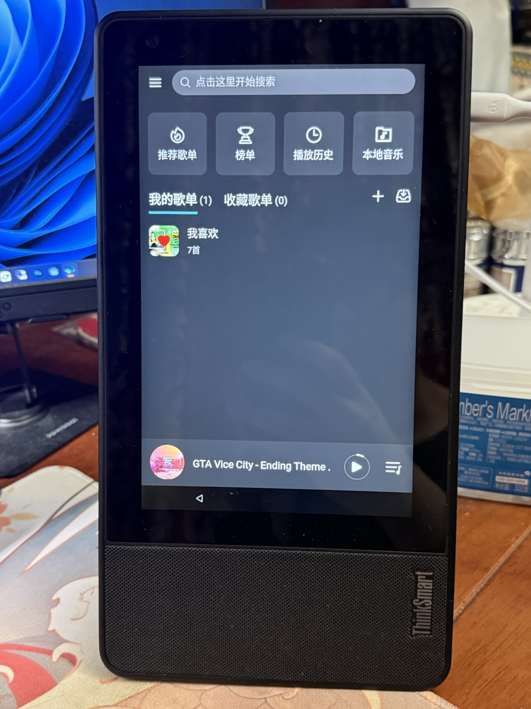
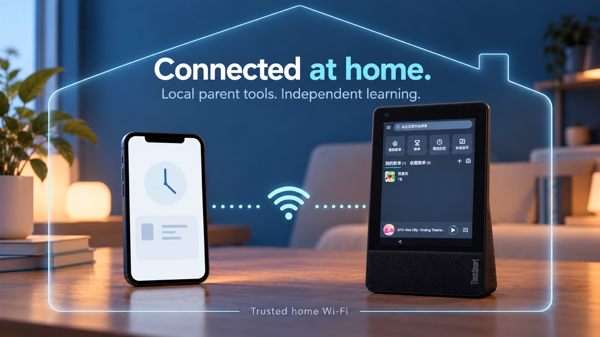

# ThinkSmart Learning Station

[English](README.en.md) | [Chinese](README.md)



*AI-generated artwork based on photographs of the real device and voice interface. Refer to the unedited device photos below for actual details.*

Give an unused **Lenovo ThinkSmart View** a second life as a family learning station: the official ChatGPT app, a manual Chinese keyboard, a large-clock dashboard, a music shortcut, and local parent tools.

This is an **alpha source preview**, not a ROM or a universal one-click flashing package. The reference environment is Android 8.1 / API 27 / ARMv7. The public source is separate from the family's device configuration. A complete installation on a second, clean device has not yet been validated.

**These are English-language documents, not a fully localized app release.** Device labels, parent pages, and keyboard integration currently remain Chinese-oriented.

## Real device photos

These are photographs of the reference device, converted to JPEG, resized, and stripped of photo metadata. The screens have not been redrawn with AI. They show a particular device and app version, not proof that every feature has passed a fresh installation test.

<table>
<tr><th>Official ChatGPT voice interface</th><th>MusicFree music interface</th></tr>
<tr><td width="50%"></td><td width="50%"></td></tr>
</table>

The voice photo shows the manual keyboard button without conversation text. The music photo shows the player interface; no music files, sources, or plugins are distributed. Two other photos containing a personal nickname or the third-party learning graph were not published.

## The idea: AI concept illustrations


**Give students space to think.** Tutoring instructions encourage questions, gradual exploration, and explanations in the student's own words. They do not guarantee that the model will never reveal an answer.



**Check from a phone; let the device run independently.** This illustrates a home-network relationship, not an actual parent dashboard. The current parent page uses HTTP: the illustration does not imply encryption or access over the public Internet.

See [image sources and generation prompts](assets/README.en.md).

## Components

| Component | What it does, and its limits |
| --- | --- |
| `dashboard` | Offline four-card home screen: ChatGPT, MusicFree, keep-screen-on, and restart confirmation. Includes a 24-hour clock, Wi-Fi signal, daily quotation, and orientation support. No third-party learning graph or graph shortcut. |
| `manual-keyboard` | Keeps the keyboard collapsed in ChatGPT until the side button explicitly opens the original Fcitx Chinese IME. No automated chat, menu, or sidebar clicks; does not read typed text. |
| `app` | Local parent service, estimated foreground usage, on-demand screen viewing, parent password changes, and an optional GeckoView web fallback. |
| `screen-toggle` | Keeps the screen on temporarily; tap again to return to the configured 30-second timeout. Requires the initialized parent service and components signed with the same key. |
| `reboot-button` | Confirmation dialog and adapter for a local FreeKiosk restart API. Requires a compatible, trusted local API and a separately configured key; unconfigured by default. |
| `docs` / `scripts` | Installation, backup, recovery, tutoring instructions, and guidance for an installation agent. |

ChatGPT, Fcitx, MusicFree, FreeKiosk, and firmware come from their respective authors. This repository does not distribute their APKs, accounts, ROMs, or music-source plugins. It is not affiliated with Lenovo or OpenAI.

## Results and known limitations

- On the reference device, the parent reported working continuous voice, photo input, and guided tutoring in the official ChatGPT app, tested with version 1.2026.293 and a separate child account. Installation and sign-in still depend on ABI, OS, service components, network, and app version.
- **Use ChatGPT in portrait orientation.** The reference device kept the sidebar collapsed when opening the keyboard in portrait, with voice and photos working. Automatic sidebar expansion in landscape remains unresolved; no automatic-click workaround is included.
- The tutoring template asks for one step at a time, no calculations on the student's behalf, and no final answer. **These are model instructions, not guaranteed enforcement.** Account and parent settings are managed by the parent.
- **The official app is not forcibly locked to one project.** Use a separate child account to avoid exposing a parent's other conversations. The dashboard alone is not system-level kiosk enforcement.
- The web fallback remains available, but continuous voice in older Gecko-based environments crashed after about 30 seconds. It is not the recommended voice entry. Experimental Firefox repackaging, native-app project guards, and automated sidebar patches are excluded.
- Parent tools estimate observed, screen-on foreground time, excluding background music. This does not measure attention. The public source adds the official app's package mapping; accuracy on other devices needs hardware testing.
- Blocked-domain events come only from this project's web fallback or compatible browser bridge. **They are not the official app's browsing, searches, or chat history, nor device-wide network logs.** Screen viewing needs Android authorization and may include visible conversations; one frame is fetched only when requested.
- The parent page uses local HTTP without transport encryption for passwords or images. Use a trusted home Wi-Fi network and do not expose the port publicly. Add encrypted access before using it remotely or on a shared network.

## Getting started

1. Read [Installation and acceptance](docs/INSTALL.en.md); check compatibility and backups first.
2. Prefer app installation when Android already works. For flashing or root, read [Flashing, backup, and recovery](docs/FLASHING.en.md) and approve a device-specific write plan separately.
3. Build from source. The installer displays a read-only plan by default; `--apply` installs the locally built components.
4. The parent privately creates the local password on the device, signs in to the child's account, and enables permissions and the keyboard. On a phone, open `http://<device-wifi-ip>:8766`.
5. Test voice, photo input, Chinese typing, screen timeout, restart, and operation without a connected computer.

### A copy-and-share prompt for your agent

> Follow https://github.com/samyeei/thinksmart-learning-station and its English installation guide to configure my connected ThinkSmart View as a learning station: first perform read-only checks of the model, OS, CPU ABI, and recovery prerequisites; save backups to the external drive I specify; build and install the dashboard, manual Chinese keyboard, parent tools, and required app shortcuts; do not install the learning graph, click inside apps automatically, or send messages; let me enter account credentials and the parent password privately on the device; before flashing, rooting, clearing data, or changing an existing signing identity, show matching image hashes, target partitions, data impact, and a recovery plan, and obtain my explicit approval; finally test portrait keyboard behavior, continuous voice, photo input, screen timeout, and operation without a computer, clearly separating tested and untested items.

## Source verification

Reference toolchain: JDK 17, Gradle 9.8.2, Android Gradle Plugin 9.4.1, and Android SDK 37.2. No private signing file outside the repository is required. Local debug builds use your own Android debug key. Configure private release signing separately before distribution, keeping collaborating components signed with the same key.

```sh
gradle --no-daemon testDebugUnitTest assembleDebug
node app/src/test/js/parent-login.test.cjs
node app/src/test/js/parent-password.test.cjs
python3 scripts/install.py --help
```

See [Validation status](docs/VALIDATION.en.md) for recorded results and untested items. A successful build does not validate sign-in, voice, cameras, or firmware recovery on another device.

## Privacy and licensing

Parents can change the local parent-page password from their phone. A successful change revokes all parent sessions. Initial enrollment is opened through ADB and cannot overwrite an existing password. The device stores a salted PBKDF2-derived hash rather than plaintext. Explain usage and screen-viewing boundaries to the child; do not use this project for covert monitoring.

Original project code is [MIT licensed](LICENSE). Dependencies retain their own licenses; see [third-party notices](THIRD_PARTY_NOTICES.en.md). The learning graph and its wrapper, family addresses, private account/project links, private chat or camera content, device identifiers, credential hashes, signing keys, and backups are excluded.
