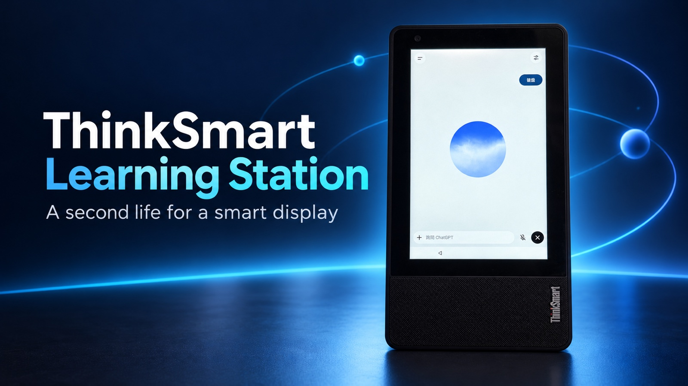
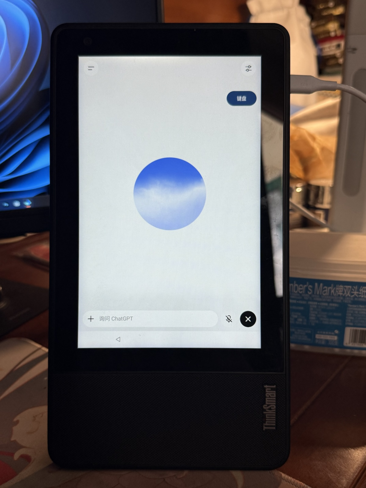
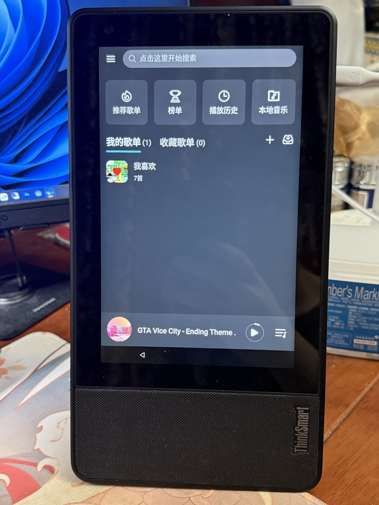
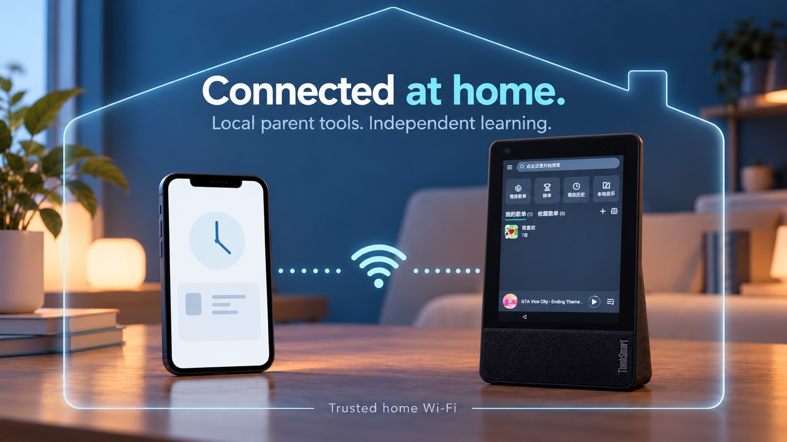

# ThinkSmart Learning Station

[Chinese](README.md) | [English](README.en.md)



*封面由内置 GPT 图片生成工具参照实物照片合成，保留竖屏机身与语音界面布局；实际细节以实拍为准。*

把闲置的 **Lenovo ThinkSmart View** 变成家庭学习终端：官方 ChatGPT App、手动中文键盘、大时钟桌面、音乐入口和局域网家长端。

这是从真实家庭设备整理出的 **源码预览版（alpha）**，不是 ROM，也不是通用一键刷机包。参考环境为 Android 8.1 / API 27 / ARMv7；公开版与家中设备配置独立。尚未在第二台全新设备上完成从零安装验收。

## 实机画面

以下两张是参考设备的真实照片，仅转为 JPEG、缩小尺寸并移除照片元数据；没有用 AI 重绘屏幕。它们展示特定设备与版本的界面，不等于所有功能已在公开版全新安装中验收。

<table>
<tr><th>官方 ChatGPT 语音界面</th><th>MusicFree 音乐界面</th></tr>
<tr><td width="50%"></td><td width="50%"></td></tr>
</table>

语音画面可见右侧手动键盘按钮，未展示对话正文；音乐画面仅展示播放器状态，不包含或提供音乐文件、音源与插件。另两张含个人昵称或第三方学习图谱的照片未上传。

## 设计理念 · AI 概念图


**让孩子经历思考过程。** 通过辅导指令鼓励提问、逐步探索和自己解释；不把“模型绝不直接给答案”作为保证。



**手机查看，设备独立运行。** 这张图仅表达家庭局域网的使用关系，不是家长端截图；当前家长页使用 HTTP，图中的连接不表示已加密，也不表示支持公网远程访问。

图片来源、生成提示词和展示边界见 [图片说明](assets/README.md)。

## 这套方案做什么

| 组件 | 功能与边界 |
| --- | --- |
| `dashboard` | 离线四卡桌面：ChatGPT、MusicFree、不息屏、确认重启；24小时大时钟、Wi-Fi信号、每日句子、横竖屏。公开版不含第三方学习图谱及其卡片。 |
| `manual-keyboard` | ChatGPT 内默认不弹键盘，右侧按钮手动展开/收起原 Fcitx 中文输入法。不自动点击聊天、菜单或侧栏，不读取输入文字。 |
| `app` | 本地家长服务、前台时长估算、按需屏幕查看、家长密码修改，以及可选 GeckoView 备用网页。 |
| `screen-toggle` | 临时保持亮屏，再点恢复系统30秒息屏；依赖已设置的家长服务与同签名组件。 |
| `reboot-button` | 带确认弹窗的 FreeKiosk 本地重启 API 适配器；需要自行配置可信的本地 API 与密钥，默认未连接。 |
| `docs` / `scripts` | 安装、备份、恢复、分步辅导模板及面向 Agent 的安装说明。 |

ChatGPT、Fcitx、MusicFree、FreeKiosk 和系统固件均由各自作者提供；本仓库不分发其 APK、账号、ROM 或音乐源插件。项目不隶属于 Lenovo 或 OpenAI。

## 使用效果与已知限制

- 参考设备的官方 ChatGPT App（实测版本1.2026.293）在孩子独立账号下，家长已验证连续语音、拍照和引导式辅导正常。是否能安装和登录，仍取决于设备 ABI、系统、服务组件、网络及官方 App 版本。
- **建议竖屏使用 ChatGPT**：参考设备竖屏展开键盘后侧栏保持收起，语音和拍照正常；横屏侧栏自动展开仍未解决，不使用自动点击绕过。
- 辅导模板要求先问思路、每次只推进一步、不代算、不直接给最终答案；这是模型行为指令，**不能保证每次都遵守**。账号和家长设置由家长本人管理。
- **没有实现官方 App 只能停留在某个项目内的强制限制。** 请使用孩子独立账号，避免把家长其他聊天暴露给孩子。桌面本身也不等于系统级封闭模式。
- 备用网页保留，但旧设备 Gecko 连续语音曾约30秒后崩溃，因此不作为连续语音的推荐入口。未分发实验性的 Firefox 改包、官方App项目限制层或自动点击侧栏补丁。
- 家长端只估算已观察到的亮屏前台时间；不包含后台听歌，也不表示实际专注。公开版增加了官方 App 包名映射，尚待其他实机核对统计精度。
- 拦截日志仅来自本项目备用网页/兼容桥，**不是官方 App 或全设备上网、搜索和聊天记录**。屏幕查看需设备端系统授权，且可能包含当前可见的聊天；仅在家长点击时获取单张画面。
- 家长页使用家庭局域网 HTTP，密码和画面没有传输加密。只在可信 Wi-Fi 使用，不做公网端口映射；需要远程或共享网络使用时，应先配置加密接入。

## 下载与配置入口

Codex、MusicFree 下载、歌曲/歌词插件目录及安装方法，以及 root 教程当前覆盖范围，统一见[资源与配置说明](docs/RESOURCES.md)。

## 开始安装

1. 阅读 [安装与验收](docs/INSTALL.md)，先核对环境与备份。
2. 已有可用 Android 优先安装应用；需要刷机或 root 时，另读 [刷机与恢复](docs/FLASHING.md)，逐台匹配材料并确认写入计划。
3. 从源码构建；安装脚本默认只读显示计划，加 `--apply` 才安装自己的组件。
4. 家长在设备上私下创建本机密码，登录孩子账号，按说明启用权限和键盘；在手机浏览器查看 `http://<设备Wi-Fi地址>:8766`。
5. 完成连续语音、拍照、中文输入、息屏、重启和脱离电脑运行的逐项验收。

### 给你的 Agent 一句话

> 请按 https://github.com/samyeei/thinksmart-learning-station 的 README 和安装指南，把我连接的 ThinkSmart View 配置成学习终端：先只读核对型号、系统、CPU ABI 和恢复条件，把备份保存到我指定的移动硬盘，构建安装桌面、手动中文键盘、家长端和所需入口，不安装学习图谱，不执行 App 自动点击或发送消息，账号登录与家长密码由我本人私下完成；刷机、root、清除数据或更换已有签名之前，先展示匹配镜像校验值、目标分区、数据影响和恢复方案并取得明确确认，最后逐项验收竖屏键盘、连续语音、拍照、息屏及脱离电脑运行，报告实测与未测项目。

## 源码验证

参考构建环境：JDK17、Gradle9.8.2、Android Gradle Plugin9.4.1、Android SDK37.2。无仓库外私有签名文件依赖；本地试用构建统一使用你自己的 Android debug key。生产分发请另设私有 release 签名，所有协作组件保持同签名。

```sh
gradle --no-daemon testDebugUnitTest assembleDebug
node app/src/test/js/parent-login.test.cjs
node app/src/test/js/parent-password.test.cjs
python3 scripts/install.py --help
```

具体结果与未测项目见 [验证说明](docs/VALIDATION.md)。构建成功不代表新设备登录、语音、相机或刷机恢复已经验证。

## 隐私与许可

家长密码可在手机家长页修改，成功后所有家长会话失效。首次设置界面由 ADB 启动，只允许初始化；已有密码不能通过首次设置覆盖。设备保存带随机盐的 PBKDF2 派生摘要，不保存明文密码。请先向孩子说明使用时长与屏幕查看范围，不以此项目进行秘密监控。

自研源码使用 [MIT](LICENSE)。第三方依赖保留各自许可，见 [THIRD_PARTY_NOTICES.md](THIRD_PARTY_NOTICES.md)。学习图谱源码/资源/封装/家庭地址、真实聊天和相机画面、设备标识、密码摘要、签名密钥和备份均不纳入仓库。
